<h1 align="center">
  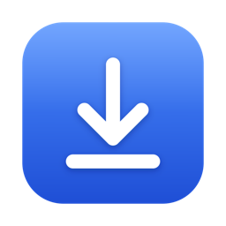<br/>
  VideoGrabber
</h1>

<p align="center"><b>The HD video downloader for Mac, Windows and Android.</b><br/>
Browse any site, tap download and pick the quality: 4K, 8K, HDR, 60 fps or audio only.</p>

<p align="center">
  
  
  
  
  
  
</p>

## Tech stack

| Layer | Desktop (macOS and Windows) | Android |
|---|---|---|
| Language | JavaScript (Node.js) · HTML · CSS | Kotlin |
| UI | Electron 33, hand-built design system (light and dark) | Jetpack Compose + Material 3 |
| Built-in browser | Chromium `<webview>`, one per tab | Android WebView, one per tab |
| Video engine | [yt-dlp](https://github.com/yt-dlp/yt-dlp) (bundled, auto-updates daily) | yt-dlp on device via [youtubedl-android](https://github.com/JunkFood02/youtubedl-android) (auto-updates daily) |
| Merging and audio | [FFmpeg](https://ffmpeg.org) (bundled) | FFmpeg (bundled) |
| YouTube JS runtime | [Deno](https://deno.land) (bundled) | QuickJS (bundled) |
| Player | HTML5 video | [Media3 / ExoPlayer](https://developer.android.com/media/media3) |
| Packaging | electron-builder: `.dmg` (Apple Silicon and Intel), `.exe` installer (NSIS) | Gradle, signed APKs (arm64, armv7, x86_64, universal) |

<p align="center">
  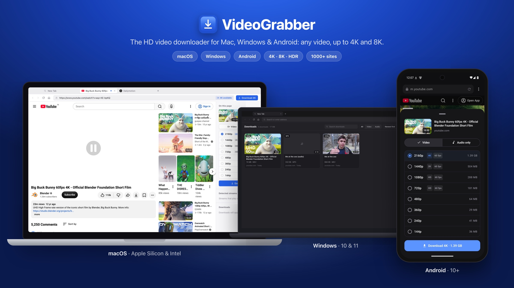
</p>

---

## Download

Grab the file for your device from the **[latest release](../../releases/latest)**. Each one includes everything it needs, so there's nothing else to install.

| Device | File | Requirements |
|---|---|---|
| **Mac**, Apple Silicon (M1, M2, M3, M4) | [VideoGrabber-mac-arm64.dmg](../../releases/latest/download/VideoGrabber-mac-arm64.dmg) | macOS 11 or later |
| **Mac**, Intel | [VideoGrabber-mac-x64.dmg](../../releases/latest/download/VideoGrabber-mac-x64.dmg) | macOS 11 or later |
| **Windows** | [VideoGrabber-Setup-win-x64.exe](../../releases/latest/download/VideoGrabber-Setup-win-x64.exe) | Windows 10 or 11, 64-bit |
| **Android**, most phones | [VideoGrabber-android-arm64.apk](../../releases/latest/download/VideoGrabber-android-arm64.apk) | Android 10 or later |
| **Android**, any device | [VideoGrabber-android-universal.apk](../../releases/latest/download/VideoGrabber-android-universal.apk) | Android 10 or later |
| **Android**, older 32-bit phones | [VideoGrabber-android-armv7.apk](../../releases/latest/download/VideoGrabber-android-armv7.apk) | Android 10 or later |
| iPhone and iPad | Coming soon | |

## Setup

### Mac

1. Download the `.dmg` for your Mac. To check which one you need, open the Apple menu → **About This Mac**: "Chip: Apple M…" means Apple Silicon; "Processor: Intel" means Intel.
2. Open the `.dmg` and drag **VideoGrabber** into **Applications**.
3. Open it. The first time, macOS says it can't verify the developer, because the app isn't notarized. Go to **System Settings → Privacy & Security**, scroll down and click **Open Anyway**. You only need to do this once.

### Windows

1. Download and run `VideoGrabber-Setup-win-x64.exe`.
2. If **"Windows protected your PC"** appears, click **More info → Run anyway**. This appears because the installer isn't code-signed yet.
3. Choose where to install. Start-menu and desktop shortcuts are created.

### Android

1. Download the APK on your phone and open it.
2. When Android asks, allow your browser or file manager to **install unknown apps**.
3. Open VideoGrabber. The first launch takes a few seconds while it sets up and updates its download engine.

> On Xiaomi, Redmi and POCO phones, if the install is blocked, turn on **Settings → Additional settings → Developer options → Install via USB**.

---

## How to use

1. **Open a video.** Search from the start page (YouTube, Google or Vimeo) or type a link. You can also tap a site: YouTube, Instagram, Facebook, TikTok, X, Vimeo, Reddit, Dailymotion.
2. **See the qualities.** VideoGrabber detects the video automatically. On desktop, the side panel lists every resolution with its file size, and the address bar shows a badge like **"4K available"**. On Android, tap the floating **⬇** button, which you can drag anywhere.
3. **Pick and download.** Choose a resolution (8K, 4K, 1440p, 1080p60 and so on) or **Audio only** (MP3, M4A, Opus, FLAC), then tap **Download**.
4. **Watch.** Downloads appear in the **Downloads** list with a thumbnail. Tap one to play it in the built-in player, or open it in your folder.

Android shortcut: in YouTube, Instagram or any other app, tap **Share → VideoGrabber**, and the quality list opens straight away.

<!-- Demo video: replace the line below with your video link or an embedded GIF/MP4 -->
> 🎬 **Demo video:** coming soon.

---

## Features

| | Mac | Windows | Android |
|---|:---:|:---:|:---:|
| Built-in browser with tabs | ✅ | ✅ | ✅ |
| Every quality: 8K / 4K / 1440p / 1080p60 / HDR | ✅ | ✅ | ✅ |
| Audio only: MP3, M4A, Opus, FLAC | ✅ | ✅ | ✅ |
| File size shown before downloading | ✅ | ✅ | ✅ |
| 1000+ supported sites | ✅ | ✅ | ✅ |
| Catches streams on other sites (HLS / DASH / MP4) | ✅ | ✅ | ✅ |
| Downloads videos that need your login | ✅ | ✅ | ✅ |
| Download history (List, Details, Cards views) with thumbnails | ✅ | ✅ | ✅ |
| Built-in video player | ✅ | ✅ | ✅ |
| Floating download button on every page | | | ✅ |
| Share → VideoGrabber from other apps | | | ✅ |
| Background downloads with notifications | ✅ | ✅ | ✅ |
| Automatic retry and resume | ✅ | ✅ | ✅ |
| Download engine updates itself daily | ✅ | ✅ | ✅ |
| Light and dark mode | ✅ | ✅ | ✅ |
| Keyboard shortcuts | ✅ | ✅ | |

Where files are saved:
- **Mac and Windows:** `Downloads/VideoGrabber` (you can change this in Settings).
- **Android:** videos go to `Movies/VideoGrabber` (visible in your Gallery) and audio to `Music/VideoGrabber`.

## Screenshots

### Desktop (Mac and Windows)

<p>
  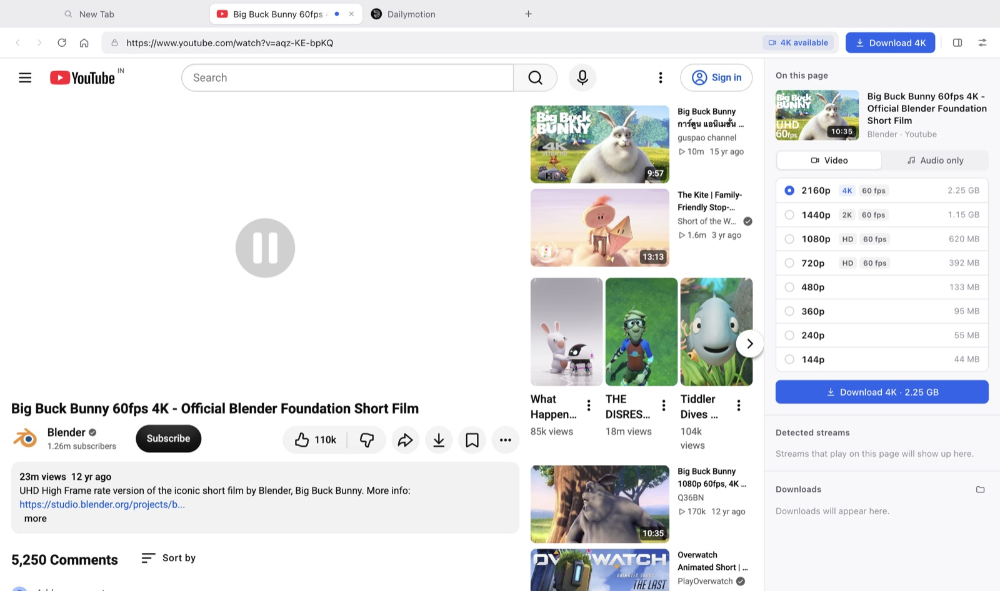
</p>
<p>
  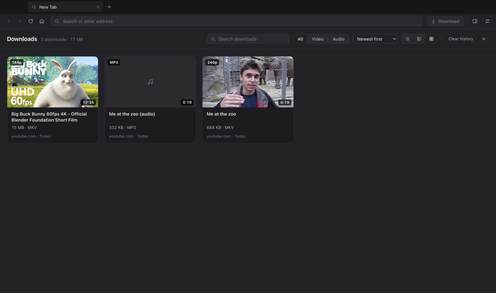
  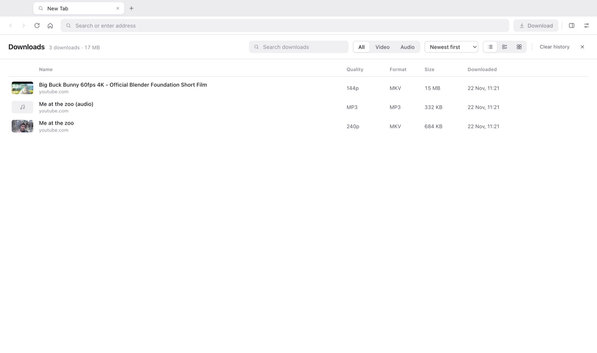
</p>
<p>
  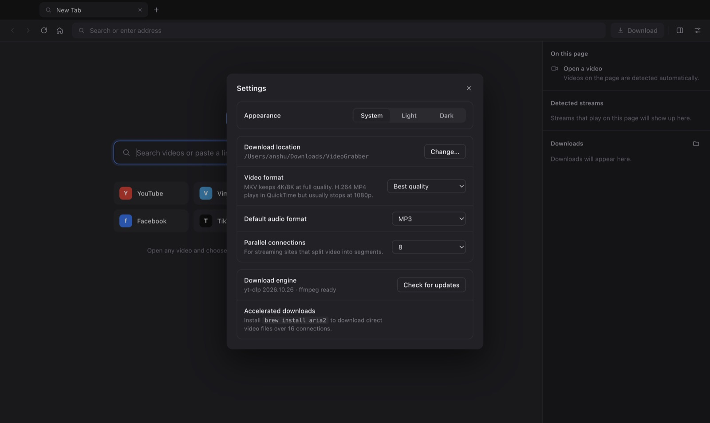
</p>

Keyboard shortcuts: <kbd>⌘/Ctrl T</kbd> new tab · <kbd>⌘/Ctrl W</kbd> close tab · <kbd>⌘/Ctrl 1–9</kbd> switch tab · <kbd>⌘/Ctrl L</kbd> address bar · <kbd>⌘/Ctrl D</kbd> download · <kbd>⌘/Ctrl ⇧ H</kbd> all downloads

### Android

<p>
  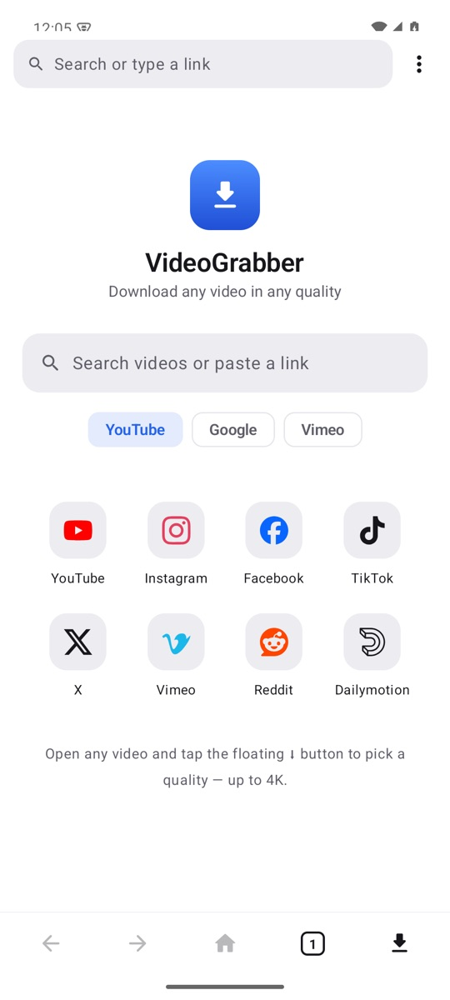
  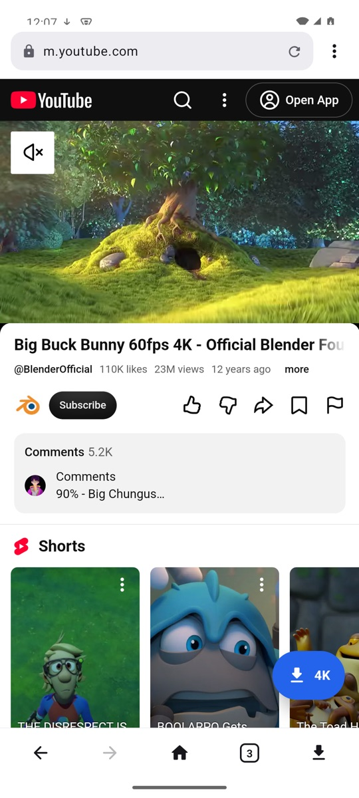
  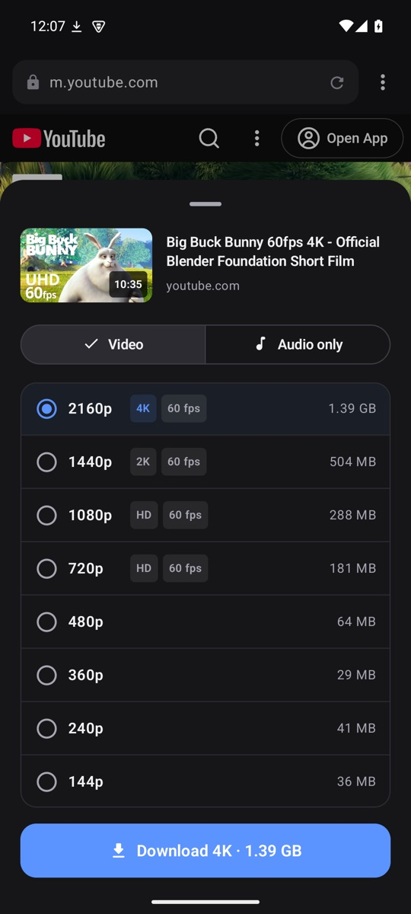
  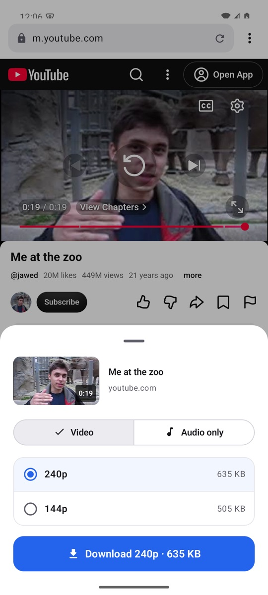
</p>
<p>
  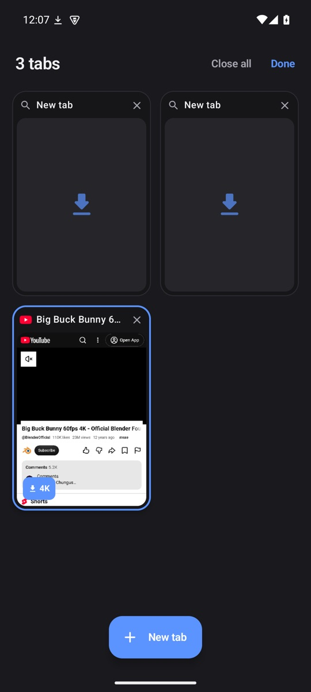
  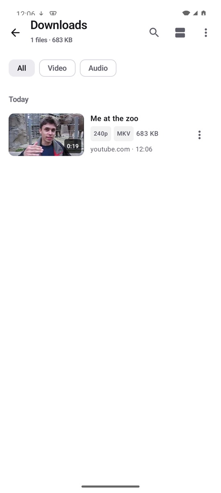
</p>

---

## Not supported

Videos protected by **DRM** (Netflix, Prime Video, Disney+, Hotstar, Spotify, Apple Music and similar) can't be downloaded, and VideoGrabber doesn't try to get around that protection.
Please download only content you have the right to save, and respect each website's terms of service.

---

## Build from source

```
VideoGrabber/
├── src/            Desktop app (Electron): main.js, renderer.js, history.js, player.js, styles.css …
├── android/        Android app (Kotlin + Jetpack Compose)
├── scripts/        fetch-binaries · after-pack (icons/signing) · collect-release
├── build/          App icons and the hero image source
└── docs/           Download page (GitHub Pages) and screenshots
```

**Desktop** (requires Node.js 20 or later):

```bash
npm install
npm start                       # run in development

npm run fetch:mac && npm run dist:mac    # → VideoGrabber-mac-arm64.dmg, VideoGrabber-mac-x64.dmg
npm run fetch:win && npm run dist:win    # → VideoGrabber-Setup-win-x64.exe (builds on macOS too)
```

**Android** (requires JDK 17 and the Android SDK; Android Studio includes both):

```bash
cd android
./gradlew assembleRelease       # → app/build/outputs/apk/release/*.apk
```

Release APKs are signed with your own key, configured in `android/keystore.properties` (git-ignored). Back the key up: Android only installs updates signed with the same key.

**Publishing a release:** run `npm run release` to copy every installer into `release/` with the names used above, then upload them to a new GitHub Release.

There's also a ready-made download page in [`docs/`](docs/index.html) that detects the visitor's device. To publish it, turn on **Settings → Pages → Deploy from branch → `main` / `docs`**.

---

## Author

**Anshu Prasad**: design, development and maintenance.

## License

© 2026 Anshu Prasad.
- The desktop app is released under the [MIT License](LICENSE).
- The Android app is released under [GPL-3.0](android/LICENSE), because it includes youtubedl-android (GPL-3.0).

Bundled tools keep their own licenses: yt-dlp (Unlicense), FFmpeg (LGPL/GPL), Deno (MIT), youtubedl-android (GPL-3.0), Media3 (Apache-2.0), and Simple Icons (CC0) for site logos. Brand names and logos belong to their owners.
